<h1 align="center">Olá! Eu sou o NOC SBNT 👋</h1>
<h3 align="center">Especialista em Redes, Monitoramento e Automação 🚀</h3>

  Com mais de <strong>6.000 contribuições nos últimos 3 anos</strong>, sou focado em infraestrutura de alta performance, automação de processos (NOC) e observabilidade completa de redes e sistemas.

---

### 🛠️ Minha Stack & Equipamentos

**Linguagens & Automação:**

**Monitoramento & Observabilidade:**

**Infraestrutura, Redes & Telecom:**

---

### 📊 Estatísticas

  
  

---

### 🐍 Minhas Contribuições (Comendo os Commits)

  <picture>
    <source media="(prefers-color-scheme: dark)" srcset="https://raw.githubusercontent.com/noc-sbnt/noc-sbnt/output/github-contribution-grid-snake-dark.svg">
    <source media="(prefers-color-scheme: light)" srcset="https://raw.githubusercontent.com/noc-sbnt/noc-sbnt/output/github-contribution-grid-snake.svg">
    
  </picture>

